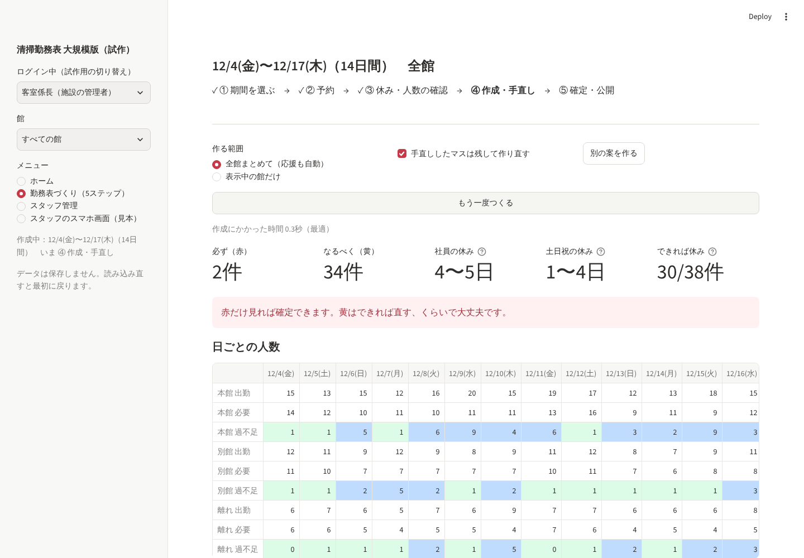

# 清掃勤務表アプリ 大規模版（試作）

スタッフ50人規模・複数の館がある旅館の、客室清掃の勤務表（14日ごと）をつくる Streamlit アプリの試作です。
架空の旅館（本館・別館・離れ、スタッフ50人、2026/12/4〜12/17）で動きます。**データはすべて架空で、保存もしません。**

公開中：https://cleaning-shift-large-ggivmwbqydxs5ajtcueh2b.streamlit.app/



## 動かし方

```
pip install -r requirements.txt
streamlit run app.py
```

Streamlit Community Cloud では、メインのファイルに `app.py` を指定します。

## できること

- **館の切り替え**：全館／本館／別館／離れ
- **5ステップ**：① 期間を選ぶ → ② 予約 → ③ 休み・人数の確認 → ④ 作成・手直し → ⑤ 確定・公開
- **② 予約**：日ごとの清掃数（アウト・連泊・アウトイン・露天風呂付き）から必要人数を自動で出す
- **③ 休み・人数の確認**：休みの希望の提出状況とまだの人、希望が集まっている日、必要人数の手直し（手直しした日は自動で上書きしない）
- **④ 作成・手直し**
  - 自動作成（OR-Tools CP-SAT）。全館まとめて作ると、館をまたぐ応援も自動で決める。50人・14日で数秒以内
  - 「必ず／なるべく」に分けた守れなかった条件の一覧。行を選ぶと勤務表のマスがオレンジになる
  - 日ごとの人数（不足は赤・多すぎは青）、公平さの数字（社員の休み、土日祝の休み、「できれば休み」がかなった数）
  - 役割・グループ・名前で絞り込み、前の期間の最後の7日を表示
  - 勤務表の表し方：太線＝必ず休みの希望、点線＝できれば休みの希望、二重線＝固定（出ない曜日・残す手直し）。土曜・日曜祝日の見出しの色、週の区切りの線、前の期間との境目の線、名前の列の固定、行の縞
  - 人ごとの出勤日数の「以上・以下・出勤」と週ごとの日数（少ないと赤・多いと青）
  - 手直し：マスを直す、人と日の範囲にまとめて入れる、2つのマスを入れ替える、元に戻す・やり直す
  - 手直ししたマスを残しての作り直し、別の案
  - 作る前のチェック：休みの希望と出ない曜日だけで守れない条件を先に一覧にし、続行・もう一度チェック・中断を選ぶ
  - 条件の強さ：「必ず」を緩める、「なるべく」を1〜3位まで選ぶ・使わない（重みの表で確かめられる）
  - 自動作成の進み具合（経過時間・見つけた案の数・いちばんよい案の点数）と、考える時間の上限
  - コピーして貼り付け（コピー元の人と日の範囲 → 貼り付け先の人と始まりの日）
- **⑤ 確定・公開**
  - 「必ず」が残っているときは一覧を見せて止める。確定するには「守れないまま確定する」と理由が必要
  - 確定・確定解除は確認の画面を出し、解除には理由が必要。確定中は④で直せない
  - 変更履歴：操作（自動作成・手直し・元に戻す・確定・解除）と、マスごとの変更（前→後、確定後かどうか）。CSVで出せる
  - 出力は確定した版から：給与・勤怠向けCSV、勤務表のExcel（館ごとのシート、表題・承認欄・人ごとの日数・日ごとの出勤／必要／過不足、A4横1ページ）
- **入力の確かめ**：②の清掃数・③の必要人数は範囲外の数を入れられず、部屋数や出られる人数を超えるとその場で知らせる
- **スタッフ管理**：絞り込み、設定のコピー、CSV取り込みの確認画面
- **スタッフのスマホ画面（見本）**：受付中は休みの希望、確定後は自分の勤務
- **権限の切り替え（試作用）**：施設の管理者・本館の作成者・見るだけの人

## 自動作成の条件

| 条件 | 強さ |
|---|---|
| 必ず休みの希望・出ない曜日 | 必ず（守る） |
| 連勤の上限（前の期間の7日も数える） | 必ず（守る）、上限の1日前は なるべく |
| 14日で2日以上の休み、パートの月の上限 | 必ず（守る） |
| 館ごとの必要人数・リーダー・チェッカー・露天風呂付き客室を担当できる人 | 必ず（守れないときは一覧に赤で出す） |
| 必要人数より多すぎない、応援は少なく、できれば休み、週の目安、飛び石の休み、新人の偏り | なるべく |
| 社員の休みの日数の差、土日祝の休みの差 | なるべく（公平さ） |

重みのもとは `solver.py` の `W` にあり、④の「条件の強さ」で画面から変えられます（1位×4・2位×3・3位×2、緩めると÷10、使わないと0）。

## ファイル

| ファイル | 中身 |
|---|---|
| `app.py` | 画面 |
| `data.py` | 架空データ（3館・50人・予約・休みの希望・前の期間の7日） |
| `demand.py` | 清掃数から必要人数を出す |
| `solver.py` | 自動作成 |
| `checks.py` | 守れなかった条件の一覧・作る前のチェック・公平さの数字 |
| `export.py` | 勤務表のExcel出力 |

## 入れていないもの

データの保存（変更履歴も読み込み直すと消えます）、本当のログイン、同時編集の確かめ（版の番号で衝突を知らせる）、スタッフへの知らせの送信、予約システムとの連携、自動作成の途中キャンセル。
